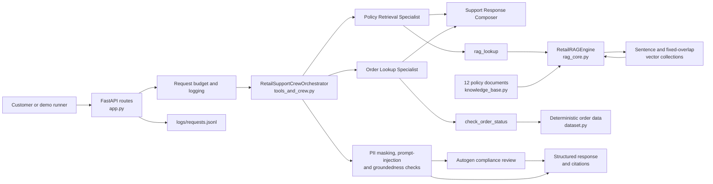
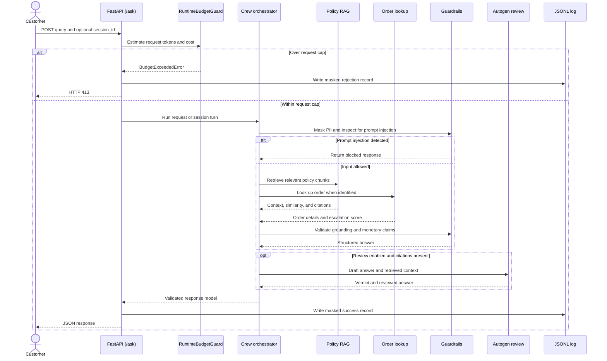
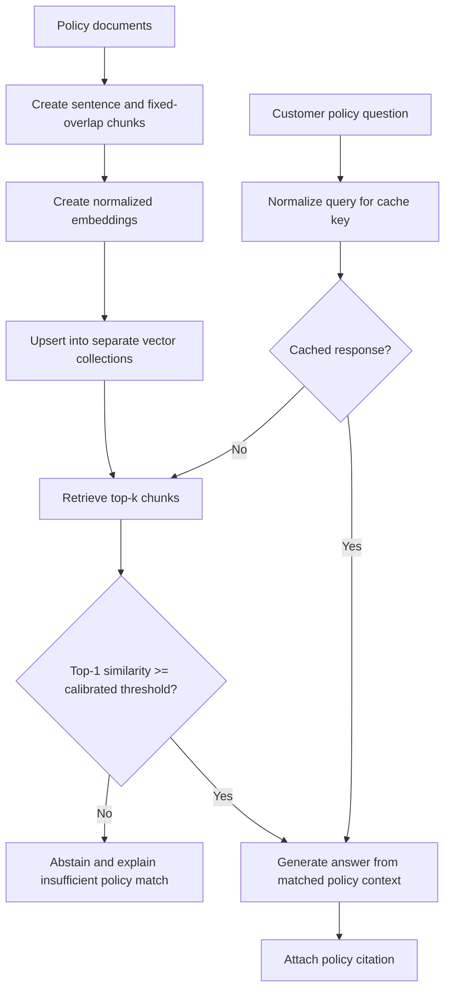

# Educational-demo disclaimer

This is an independent, unofficial academic demonstration. It is not affiliated with, endorsed by, or operated by Nykaa or any other retailer. The policy knowledge base and order records are fictional test fixtures, not actual company policies, customer data, or service commitments. Do not use the output to make real customer-service decisions.

# Retail Customer-Support Agent (Educational Demo) — Project Guide

This guide describes the repository architecture, request and data flows, HTTP
interfaces, safeguards, and commands for running the retail customer-support
agent. The existing [README](./README.md) contains the detailed capstone task
specification and graded measurements; this guide focuses on how the
implementation fits together and how to operate it.

## 1. Project overview

The application answers illustrative retail support questions using two synthetic sources:

- A deterministic, generated in-memory dataset of 50 order records.
- A policy knowledge base of 12 documents, indexed for semantic retrieval.

A CrewAI-style three-agent workflow uses dedicated policy and order lookup
tools before composing a response. Input/output guardrails, optional
Autogen-based review, session memory, structured request logging, and a FastAPI
interface wrap that workflow.

The FastAPI application defaults to local Ollama with `gemma4:latest` at
`http://127.0.0.1:11434`; configure these values with `OLLAMA_MODEL` and
`OLLAMA_HOST`. `MOCK_LLM=true` remains available for deterministic offline
checks, selected explicitly with `run_all_demos.py --mock` or through the
environment. The demo runner also defaults to local Ollama. CrewAI and
OpenTelemetry telemetry are disabled in either mode. Model inference in the
default mode requires the local Ollama service and configured model to be
available.

## 2. Architecture



### Repository map

| File or directory | Responsibility |
| --- | --- |
| [`app.py`](./app.py) | FastAPI application, request/response models, `/ask`, `/add-document`, `/health`, WebSocket chat, and masked JSONL logging. |
| [`dataset.py`](./dataset.py) | Seeded order generation, order lookup map, and dataset validation/reporting. |
| [`knowledge_base.py`](./knowledge_base.py) | The 12 policy documents and their metadata. |
| [`rag_core.py`](./rag_core.py) | Chunking, embedding, vector indexing/retrieval, similarity calibration, grounded answers, evaluation, and response caching. |
| [`tools_and_crew.py`](./tools_and_crew.py) | Order and RAG tools, the mock LLM adapter, agent orchestration, session memory, PII/prompt guardrails, and structured response validation. |
| [`evaluation.py`](./evaluation.py) | Fifteen-query mock evaluation across policy topics, order/policy combination, out-of-scope input, and prompt injection. |
| [`governance_and_review.py`](./governance_and_review.py) | Structured policy review, risk/budget controls, caching demonstration, and governance report. |
| [`_offline_compat.py`](./_offline_compat.py) | Local compatibility implementations used when selected optional agent or vector-store packages are unavailable. Pydantic, NumPy, and LangGraph are imported directly and must be installed. |
| [`run_all_demos.py`](./run_all_demos.py) | Runs the four-part verification sequence with Ollama by default; supports explicit deterministic mock mode with `--mock`, records per-stage and overall UTC timing, and logs the active stage plus elapsed runtime every minute. |
| [`requirements.txt`](./requirements.txt) | Python runtime and verification dependencies. |
| [`logs/`](./logs) | JSON Lines request log output. |
| [`transcripts/`](./transcripts) | Generated execution transcripts. |

## 3. Request lifecycle

The standard HTTP request lifecycle is shown below. The compliance review is
enabled by default for `/ask` and runs when a cited policy document is
available; clients can disable it with `run_autogen_review: false`.



### Agent responsibilities and tool access

| Agent | Tool access | Responsibility |
| --- | --- | --- |
| Policy Retrieval Specialist | `rag_lookup` | Fetch policy chunks and return similarity, citations, and grounded policy text. |
| Order Lookup Specialist | `check_order_status` | Look up the requested order and calculate an escalation score. |
| Support Response Composer | None | Combine the preceding task outputs into a customer-facing answer. |

The order tool enforces least autonomy: it may only be bound to and invoked by
the `Order Lookup Specialist`. An unauthorized binding or invocation raises
`PermissionError`.

## 4. Knowledge retrieval and response grounding

`RetailRAGEngine` indexes every policy document into two collections:

1. **Sentence-based** (`retail_demo_kb_sentence`): one complete sentence per chunk.
2. **Fixed overlap** (`retail_demo_kb_fixed_overlap`): 160-character chunks with a
   40-character overlap.

The engine embeds and queries the collections using cosine similarity. Its
default deterministic local embedder creates 384-dimensional vectors. A local
SentenceTransformer may be explicitly enabled with
`FORCE_REAL_SENTENCE_TRANSFORMERS=true` when the corresponding model is already
available locally; the loader requests `local_files_only=True`.



The similarity threshold is calculated from in-scope and out-of-scope
calibration queries. Results below the threshold cause the RAG engine to
abstain. The output groundedness guardrail also rejects a response if an
unmatched order and insufficient policy similarity leave no valid basis to
answer, or if a rupee amount in the draft is absent from the retrieved policy
and order context.

Responses are cached in memory by strategy, `top_k`, and normalized query
(lowercased, whitespace-collapsed, and stripped of trailing punctuation).
Adding a policy document re-indexes both collections and clears this cache.
The cache is process-local and is not persisted across restarts.

## 5. Order data and escalation

`dataset.py` generates orders with seed `42` by default. The record IDs run
from `ORD-1001` to `ORD-1050`; each includes category, status, order value,
days since creation, and delayed-shipment state.

The order tool computes:

```text
recency_norm = clamp(days_since_created / 30, 0, 1)
escalation_score = round(0.55 * delayed_shipment + 0.45 * recency_norm, 4)
```

An order is marked for human escalation when its score is at least `0.65`.
This is a recommendation in the response; the application does not execute
refunds, change order state, or otherwise mutate order data.

## 6. Safety, governance, and observability

- **PII masking:** The input flow masks recognized Indian phone numbers and
  payment-card last-four patterns. The logger masks request text before
  writing it to disk. Free-text names and addresses are not covered by the
  fixed-format masking rules.
- **Prompt-injection detection:** Selected instruction-override and
  policy-bypass patterns are blocked before the agent workflow proceeds.
  This is a pattern-based guardrail, not a general-purpose security filter.
- **Groundedness:** The final draft is checked against retrieved policy and
  order payloads. Unsupported answers or unsupported rupee claims are refused.
- **Compliance review:** `/ask` runs the two-agent review by default when
  citations exist. The API response exposes the review verdict when produced.
- **Runtime budget:** The default API budget cap is 450 estimated tokens and
  ₹0.54 estimated per request. Requests over either cap are logged as rejected
  and return HTTP `413`.
- **Structured logs:** `logs/requests.jsonl` contains one JSON object per line,
  including timestamp, trace ID, endpoint, session, masked request text,
  latency, and status.
- **Session memory:** A provided `session_id` on `/ask` or the WebSocket is
  mapped to a LangGraph `InMemorySaver` thread for follow-up resolution.
  Sessions are process-local and reset on restart.
- **Risk and autonomy:** The project classifies this support use case as
  medium risk and gives tools read-only access to local policy/order data.

## 7. HTTP and WebSocket API

Start the API from the repository root after installing dependencies:

```powershell
Copy-Item .\.env.example .\.env
.\.venv313\Scripts\python.exe -m uvicorn app:app --host 127.0.0.1 --port 8000
```

The application loads `.env` when the orchestration module is imported. The checked-in `.env.example` contains safe local-demo defaults and no credentials.
The default settings are `MOCK_LLM=false`, `OLLAMA_HOST=http://127.0.0.1:11434`,
`OLLAMA_MODEL=gemma4:latest`, and `OLLAMA_TIMEOUT_SECONDS=1800` (30 minutes).
Set
`MOCK_LLM=true` in `.env` to select the deterministic mock adapter instead.
Keep Ollama running locally and ensure the configured model is present
(`ollama list`); model connection and inference errors are returned explicitly
rather than silently switching to mock mode.

Interactive API documentation is available at `http://127.0.0.1:8000/docs`.
The server logs its current state and uptime at startup and every 60 seconds;
while idle the status is `Waiting for requests`, and active HTTP request paths
are shown while requests are being processed.

### `GET /health`

Returns service status and the mock/telemetry/risk settings.

### `POST /ask`

Request:

```json
{
  "query": "What is the return policy for Apparel order ORD-1002?",
  "session_id": "optional-session-id",
  "run_autogen_review": true
}
```

`session_id` is optional. Set `run_autogen_review` to `false` to skip the
optional review stage. The response includes a `trace_id`, masked query,
answer, citations, optional order details and escalation score, invoked tools,
guardrail status, optional review verdict, and latency. Requests exceeding the
budget return `413`; request validation errors are handled by FastAPI/Pydantic.

### `POST /add-document`

Request:

```json
{
  "doc_id": "DOC-13",
  "topic": "gift_card_policy",
  "title": "Gift Card Policy",
  "text": "Policy text must contain at least 20 characters."
}
```

The route validates the request model, adds or replaces the document by
`doc_id`, rebuilds both vector collections, clears the response cache, logs
the operation, and returns the document ID and resulting collection counts.
This endpoint updates only the running process; it does not persist documents
to a database or file.

### `WS /ws/chat`

Connect to `/ws/chat` and send JSON text messages with `query` and optionally
`session_id`:

```json
{"session_id": "chat-01", "query": "Check order ORD-1004"}
```

Each reply contains a trace ID, session ID, masked query, answer, citations,
whether prior session memory was used, and latency. If no session ID is sent,
the server generates one for the connection. A normal client disconnect is
logged as `client_disconnected_gracefully`. Synchronous CrewAI work is
dispatched to Starlette's worker thread pool so it does not run inside the
WebSocket's active asyncio event loop.

## 8. Installation and running

Create/activate a virtual environment if needed, then install the declared
dependencies:

```powershell
python -m venv .venv313
.\.venv313\Scripts\python.exe -m pip install -r requirements.txt
```

The AutoGen dependencies are constrained to the `0.4.x` API because the
project's mock model client and structured-review workflow target that
interface. The checked-in, git-ignored `.env` defaults to local Ollama
(`MOCK_LLM=false`, `gemma4:latest`) so the project is ready to run locally.

Run the complete demo suite with local Ollama by default:

```powershell
.\.venv313\Scripts\python.exe .\run_all_demos.py
```

For a deterministic mock run, opt in explicitly:

```text
.\.venv313\Scripts\python.exe .\run_all_demos.py --mock
```

The runner always disables CrewAI/OpenTelemetry telemetry before importing
application modules. Its default uses the configured local Ollama model; the
`--mock` option forces `MOCK_LLM=true` for reproducible offline acceptance
checks.

It executes the knowledge-base and dataset checks, RAG evaluation, agent
demonstrations, FastAPI endpoint/logging checks, the 15-query evaluation, and
governance demonstrations. The transcript is saved to
`transcripts/full_execution_transcript.txt` and includes UTC start/end timestamps
and monotonic elapsed durations for each report stage and for the overall run.
While the runner executes, INFO logs show the current stage and elapsed runtime
on stage changes and every 60 seconds, even when a stage takes a long time.

Individual module reports can be run from the repository root:

```powershell
.\.venv313\Scripts\python.exe .\dataset.py
.\.venv313\Scripts\python.exe .\knowledge_base.py
.\.venv313\Scripts\python.exe .\rag_core.py
.\.venv313\Scripts\python.exe .\tools_and_crew.py
.\.venv313\Scripts\python.exe .\app.py
.\.venv313\Scripts\python.exe .\evaluation.py
.\.venv313\Scripts\python.exe .\governance_and_review.py
```

The individual scripts are demonstrations/reports, not separate persistent
services. For a running API, use the Uvicorn command in the API section.

## 9. Verification coverage

The demo suite exercises:

1. Seeded order generation and dataset constraints.
2. Policy document validation and both chunking/indexing strategies.
3. Similarity threshold calibration, retrieval metrics, and cache behavior.
4. Order lookup, escalation, agent tool routing, and multi-turn memory.
5. PII masking, prompt-injection blocking, structured output, and groundedness.
6. FastAPI health, ask, document-ingestion, WebSocket, and JSONL logging paths.
7. Fifteen representative evaluation queries and compliance/governance checks.

The mock evaluator is deterministic and useful for regression/demo verification;
its scores should not be interpreted as an independent production-quality
assessment of a live language model.

## 10. Current implementation boundaries

- Orders, sessions, response cache, and dynamically added policy documents are
  in-memory only.
- The checked-in app is a capstone/demo implementation, not a production
  deployment configuration with authentication, durable storage, or
  multi-process coordination.
- PII masking targets specified phone and card patterns and does not guarantee
  removal of all personally identifying information.
- Prompt-injection pattern matching covers known examples rather than every
  possible attack.
- The local embedding compatibility implementation is deterministic and
  domain-oriented; it is not equivalent to a general-purpose semantic model
  for arbitrary production queries.
- The acceptance transcript reports behavior for the repository's controlled
  fixtures and mock execution path.


## Security and deployment boundary

The API is intended for local demonstration. It has no production authentication or authorization. In particular, protect `/add-document` and `/ws/chat` before any network-facing deployment. Bind to `127.0.0.1` by default; do not expose the service publicly or connect real customer data without a security and privacy review. PII masking and prompt-injection checks are limited demonstrations, not comprehensive controls.
